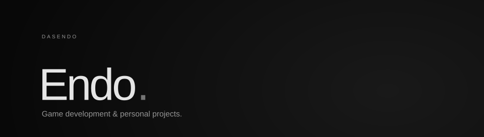
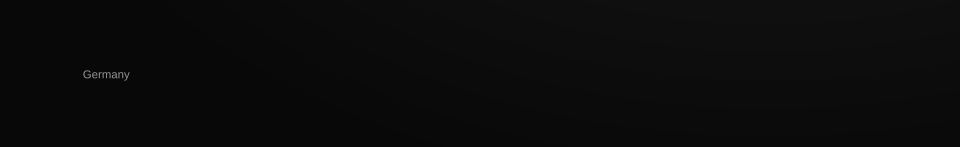

  <picture><source media="(max-width: 600px)" srcset="assets/menu-header-mobile.svg"></picture> 
  <a href="https://dasendo.github.io/about/"><picture><source media="(max-width: 600px)" srcset="assets/menu-about-mobile.svg"></picture></a> 
  <a href="https://dasendo.github.io/toolbox/"><picture><source media="(max-width: 600px)" srcset="assets/menu-toolbox-mobile.svg"></picture></a> 
  <a href="https://dasendo.github.io/contact/"><picture><source media="(max-width: 600px)" srcset="assets/menu-connect-mobile.svg"></picture></a> 
  <picture><source media="(max-width: 600px)" srcset="assets/menu-footer-mobile.svg"></picture>

